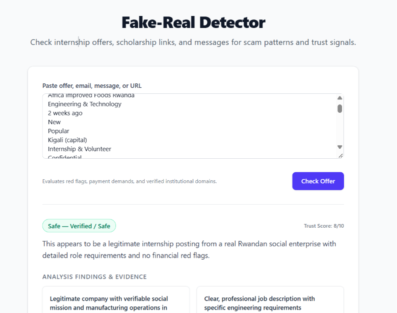
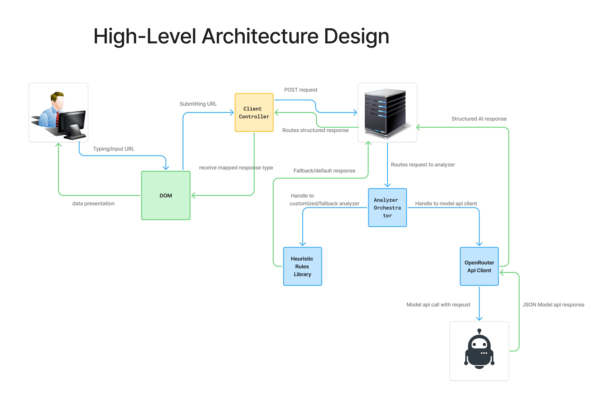
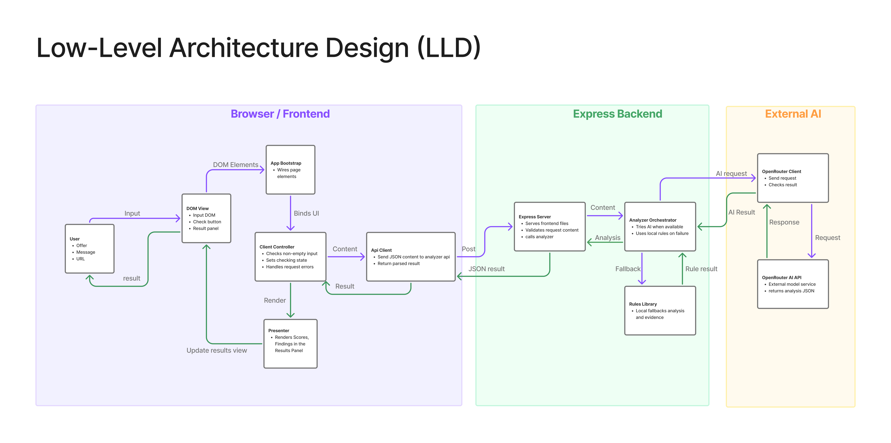
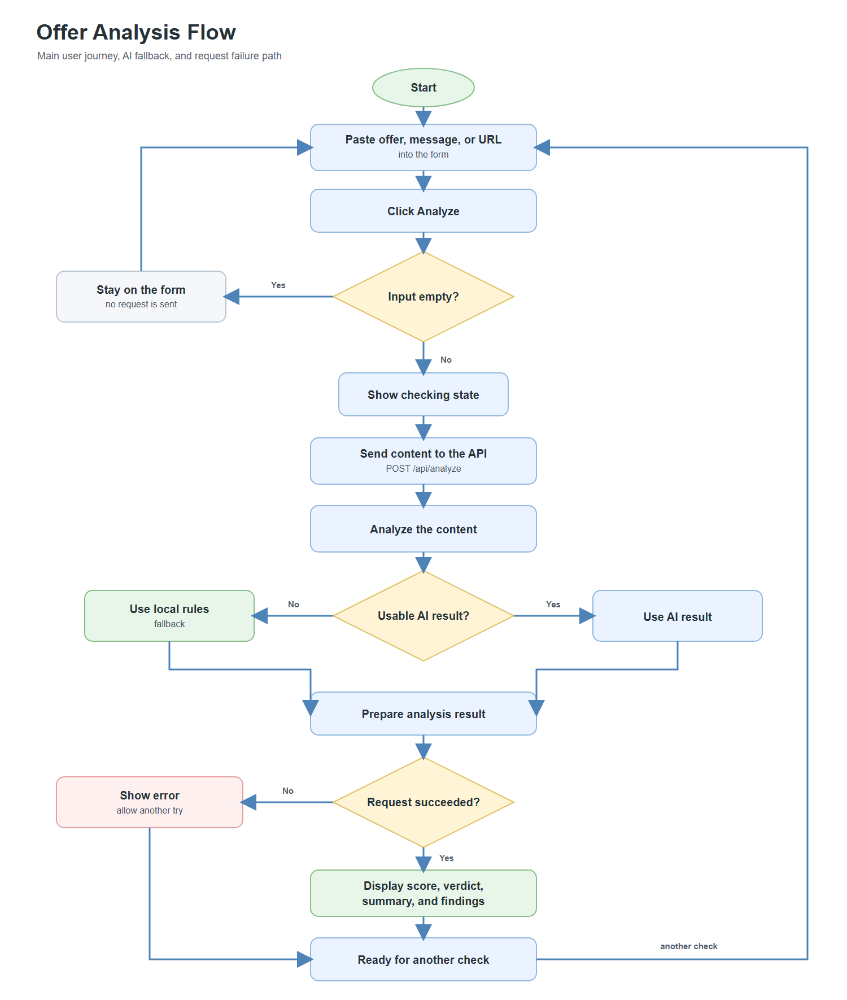

<div align="center">
  <a href="https://github.com/princeAlan25/intern-detector">
    
  </a>
  <h1>Fake-Real Detector</h1>
  <p>An AI-powered and heuristic scam detection engine that verifies internship offers, scholarship notices, and recruiter outreach for students and job seekers.</p>
  <p>
    <a href="https://github.com/princeAlan25/intern-detector/actions"></a>
    <a href="https://github.com/princeAlan25/intern-detector/releases"></a>
    <a href="LICENSE"></a>
  </p>
  <p>
    <a href="#about">About</a> &middot;
    <a href="#features">Features</a> &middot;
    <a href="#architecture--visual-workflows">Architecture</a> &middot;
    <a href="#getting-started">Getting Started</a> &middot;
    <a href="https://github.com/princeAlan25/intern-detector/issues/new?template=bug_report.md">Report a bug</a> &middot;
    <a href="https://github.com/princeAlan25/intern-detector/issues/new?template=feature_request.md">Request a feature</a>
  </p>
</div>

<div align="center">
  <p>
    
    <br>
  </p>
</div>

<details>
  <summary><strong>Table of contents</strong></summary>

  * [About](#about)
  * [Features](#features)
  * [Architecture & Visual Workflows](#architecture--visual-workflows)
    * [High-Level Architecture](#high-level-architecture)
    * [Low-Level Component Architecture](#low-level-component-architecture)
    * [Decision & Analysis Flowchart](#decision--analysis-flowchart)
    * [Sequence Diagram](#sequence-diagram)
  * [Getting started](#getting-started)
    * [Prerequisites](#prerequisites)
    * [Installation](#installation)
    * [Running the Application](#running-the-application)
  * [Usage](#usage)
  * [Configuration](#configuration)
  * [Project structure](#project-structure)
  * [Development](#development)
  * [Roadmap](#roadmap)
  * [Contributing](#contributing)
  * [Security](#security)
  * [License](#license)
  * [Acknowledgements](#acknowledgements)
  * [Contact](#contact)
</details>

## About

**Fake-Real Detector** is an open-source security tool built to protect students and early-career professionals from predatory recruitment scams. Fraudulent remote internship postings, advance-fee equipment checks, identity theft schemes, and unverified messaging channel solicitations have grown increasingly sophisticated. Fake-Real Detector provides an instant, transparent line of defense by analyzing job postings, scholarship announcements, and email pitches.

The platform employs a hybrid dual-strategy analysis engine: deep contextual semantic evaluation via **OpenRouter LLMs** combined with a zero-latency deterministic **heuristic rules engine**. Whether evaluating suspicious advance fee demands or verifying recognized educational credentials, the system outputs an actionable **Trust Score (1–10)**, an unequivocal verdict (**Safe**, **Caution**, or **High Risk**), and transparent cited evidence.

**Built with:**
* **Language & Framework:** [TypeScript](https://www.typescriptlang.org/) (Strict mode), [Node.js](https://nodejs.org/), [Express 5](https://expressjs.com/)
* **Styling & Build:** [Tailwind CSS v4](https://tailwindcss.com/), [esbuild](https://esbuild.github.io/)
* **AI & Intelligence:** [OpenRouter API](https://openrouter.ai/) (supporting leading open-weights models like Basesten Elephant, NVIDIA Nemotron, Meta LLaMA 3.3)
* **Testing:** Native Node.js Test Runner (`node:test`)

---

## Features

* **Dual-Strategy Scam Analysis**: Leverages large language models via OpenRouter for nuanced linguistic and contextual reasoning, backed by a deterministic regex rules engine.
* **Automatic Heuristic Fallback**: Resilient offline capability—if no API key is provided or OpenRouter experiences downtime, the system instantly executes local heuristic checks without service degradation.
* **Granular Red Flag & Trust Signal Detection**:
  * Detects upfront fee requirements, onboarding equipment deposits, and check-cashing requests.
  * Flags suspicious off-platform communication redirects (Telegram, WhatsApp).
  * Warns on corporate recruiter pitches dispatched from free email providers (`@gmail.com`, `@yahoo.com`).
  * Identifies inflated, unrealistic student salaries (e.g. \$80+/hr for entry-level tasks).
  * Rewards legitimate institutional domains (`.edu`) and recognized applicant tracking systems (Greenhouse, Lever, Workday).
* **Transparent Evidence Citation**: Extracts and displays exact quotes from the analyzed text directly beneath the verdict to clarify *why* a posting was flagged.
* **Controller-Presenter Frontend**: Built with strict separation of concerns, featuring a Silent Empty Guard, reactive trust score color badges, and full accessibility support.

---

## Architecture & Visual Workflows

### High-Level Architecture
The system operates as an integrated monorepo consisting of a lightweight browser frontend and an Express-powered backend API orchestrating the dual analyzer engines:

<p align="center">
  
</p>

### Low-Level Component Architecture
A modular breakdown detailing the communication between controllers, presenters, orchestrators, strategy implementations, and heuristic rule evaluators:

<p align="center">
  
</p>

### Decision & Analysis Flowchart
The step-by-step logic path followed during every analysis request, showing the fallback path and score clamping:

<p align="center">
  
</p>

### Sequence Diagram
An end-to-end trace of user interaction from input submission on the dashboard to backend validation, OpenRouter orchestration, and DOM rendering:

<p align="center">
  
</p>

---

## Getting started

### Prerequisites

| Requirement | Version | Note |
| :--- | :--- | :--- |
| **Node.js** | 20.0.0 or later | Node 20+ with native `fetch` and `node:test` support |
| **npm** | 10.0.0 or later | Monorepo workspace support enabled |
| **OpenRouter API Key** | Optional | Required only for LLM semantic evaluation; heuristics run standalone |

### Installation

> [!NOTE]
> Fake-Real Detector is designed to run seamlessly on Windows, macOS, and Linux without external database setup.

1. **Clone the repository:**
   ```bash
   git clone https://github.com/princeAlan25/intern-detector.git
   cd intern-detector
   ```

2. **Install all dependencies across the monorepo:**
   ```bash
   npm install
   ```

3. **Configure your environment:**
   ```bash
   cp .env.example .env
   ```
   *(See [Configuration](#configuration) below for details.)*

### Running the Application

You can launch the entire stack in one command or run the frontend and backend in dedicated development shells.

#### Option 1: Unified All-in-One Server (Recommended)
Builds and starts the Express backend, which serves both the `/api/analyze` REST API and the static web UI on a single port:

```bash
npm run dev
# or
npm start
```
The application will be live at **`http://localhost:3000`**.

#### Option 2: Independent Development (Frontend & Backend Separate)
If you are iterating on the frontend UI or backend rules independently:

* **Terminal 1 (Backend API):**
  ```bash
  npm run dev:backend
  ```
  *Listens on `http://localhost:3000`.*

* **Terminal 2 (Frontend with Live CSS Watcher):**
  ```bash
  npm run dev:frontend
  ```
  *Builds Tailwind CSS and serves the frontend on an alternate port (e.g. `http://localhost:5000` or via Vite).*

---

## Usage

### 1. Web Dashboard
1. Open `http://localhost:3000` in your browser.
2. Paste any job posting, internship offer email, scholarship announcement, or outreach message into the text area.
3. Click **"Verify Posting"**.
4. Review the generated **Trust Score (1–10)**, the overarching verdict badge, and the structured findings with highlighted quotes.

### 2. REST API Direct Call

You can integrate Fake-Real Detector into external scrapers, bots, or browser extensions via HTTP POST:

**Request:**
```bash
curl -X POST http://localhost:3000/api/analyze \
  -H "Content-Type: application/json" \
  -d '{"content": "Urgent internship opportunity! Earn $85/hour data entry. Send $150 deposit for company equipment via Western Union. Contact recruiter on Telegram @FastHiring."}'
```

**Response (`HTTP 200 OK`):**
```json
{
  "trustScore": 2,
  "verdict": "High Risk",
  "reasons": [
    "Requires upfront payment or deposit for equipment or processing.",
    "Unrealistically high compensation for student or entry-level position.",
    "Redirects communication to unofficial channels like Telegram or WhatsApp."
  ],
  "evidence": [
    "Send $150 deposit for company equipment",
    "Earn $85/hour",
    "Contact recruiter on Telegram"
  ]
}
```

---

## Configuration

Settings are configured via environment variables located in `.env` at the project root. Copy `.env.example` to get started:

| Variable | Required | Default | Description |
| :--- | :--- | :--- | :--- |
| `PORT` | No | `3000` | Port on which the Express backend and static server listen. |
| `OPENROUTER_API_KEY` | No | *empty* | Your OpenRouter secret key. When omitted, the app smoothly uses the local heuristic engine. |
| `OPENROUTER_MODEL` | No | `baseten/elephant-1:free` | Model ID on OpenRouter to use for AI scam evaluations (e.g., `nvidia/nemotron-3-ultra-550b-a55b:free`, `meta-llama/llama-3.3-70b-instruct`). |

---

## Project structure

```text
intern-detector/
├── backend/                  # Backend workspace package
│   ├── src/
│   │   ├── analyzer/         # Core analysis strategy implementations
│   │   │   ├── heuristics.ts # Regex & deterministic rule evaluations
│   │   │   ├── openrouter.ts # OpenRouter API client & JSON schema parsing
│   │   │   └── orchestrator.ts# Strategy orchestrator with automatic fallback
│   │   ├── server.ts         # Express server, static file host, & REST routing
│   │   └── types.ts          # Shared TypeScript type definitions
│   └── package.json
├── frontend/                 # Frontend workspace package
│   ├── dist/                 # Compiled assets (app.js, output.css)
│   ├── src/
│   │   ├── api.ts            # Client-side API request handler with fallback
│   │   ├── app.ts            # Main entry point bootstrapping the application
│   │   ├── controller.ts     # User interaction logic & Silent Empty Guard
│   │   ├── presenter.ts      # Pure DOM rendering & dynamic badge themes
│   │   ├── style.css         # Tailwind CSS source styles
│   │   └── types.ts          # Frontend data models and contracts
│   ├── index.html            # Single-page application HTML interface
│   └── package.json
├── resources/                # Architectural diagrams, flowchart, icons & assets
│   ├── app-icon.gif          # Application branding icon
│   ├── full-flowchart.png    # End-to-end evaluation flowchart
│   ├── high-level-architecture.png
│   ├── low-level-architecture.png
│   └── mermaid-diagram.svg   # Sequence diagram
├── scripts/                  # Development & diagnostics scripts
│   └── test-openrouter.ts    # Isolated OpenRouter connectivity verification
├── .env.example              # Sample environment variable template
├── CHANGELOG.md              # Project version history and changes
├── CODE_OF_CONDUCT.md        # Community guidelines
├── CONTRIBUTING.md           # Contribution guidelines & code standards
├── LICENSE                   # MIT License
├── package.json              # Root workspace orchestrator
├── SECURITY.md               # Security vulnerability reporting policy
└── tsconfig.json             # Root TypeScript compilation configuration
```

---

## Development

Fake-Real Detector maintains test coverage across both workspaces using Node's native test runner:

```bash
# Run all 31 unit & integration tests across both workspaces
npm test

# Run backend tests only (heuristics, OpenRouter parser, API endpoints)
npm run test:backend

# Run frontend tests only (controller, sanitization, presenter themes)
npm run test:frontend

# Test live connectivity with your OpenRouter API key and selected model
npm run test:openrouter

# Recompile frontend styles with Tailwind CSS CLI
npm run build:css --workspace=frontend

# Bundle frontend client scripts with esbuild
npm run build:js --workspace=frontend
```

---

## Roadmap

- [x] Monorepo workspace configuration (`@intern-detector/backend` and `@intern-detector/frontend`).
- [x] Heuristic rules engine flagging upfront fees, excessive pay, Telegram redirects, and free email domains.
- [x] Institutional trust signal verification (`.edu`, known ATS portals).
- [x] OpenRouter LLM integration with automatic zero-latency heuristic fallback.
- [x] Responsive web dashboard with Trust Score gauge and quote evidence citations.
- [x] Comprehensive automated test suite (31 unit & integration tests).
- [ ] Browser extension for automatic one-click evaluation on LinkedIn, Indeed, and Handshake.
- [ ] Direct file upload support for PDF offer letters and resume attachments.
- [ ] Community scam reporting registry and shared fraud database.

Proposed features and bugs are tracked in the [issue tracker](https://github.com/princeAlan25/intern-detector/issues). Release notes are available in [CHANGELOG.md](CHANGELOG.md).

---

## Contributing

Contributions are warmly welcomed! Please read [CONTRIBUTING.md](CONTRIBUTING.md) for details on code standards, the Controller-Presenter architecture, and the pull request workflow. By participating, you agree to adhere to the [Code of Conduct](CODE_OF_CONDUCT.md).

---

## Security

Please do not report security vulnerabilities through public GitHub issues. Follow the confidential disclosure instructions outlined in [SECURITY.md](SECURITY.md).

---

## License

Distributed under the **MIT License**. See [LICENSE](LICENSE) for full details.

---

## Acknowledgements

* [OpenRouter](https://openrouter.ai/) for accessible, multi-model AI inference.
* [Tailwind CSS](https://tailwindcss.com/) for utility-first styling.
* [esbuild](https://esbuild.github.io/) for high-performance JavaScript bundling.
* [Devpost Build With AI Hackathon](https://devpost.com/) for the inspiration to protect job-hunting students and interns.

---

## Contact

* **Maintainer:** Prince Alain Loui ([princealainloui@gmail.com](mailto:princealainloui@gmail.com))
* **GitHub Repository:** [princeAlan25/intern-detector](https://github.com/princeAlan25/intern-detector)
* **Discussions & Ideas:** [GitHub Discussions](https://github.com/princeAlan25/intern-detector/discussions)
