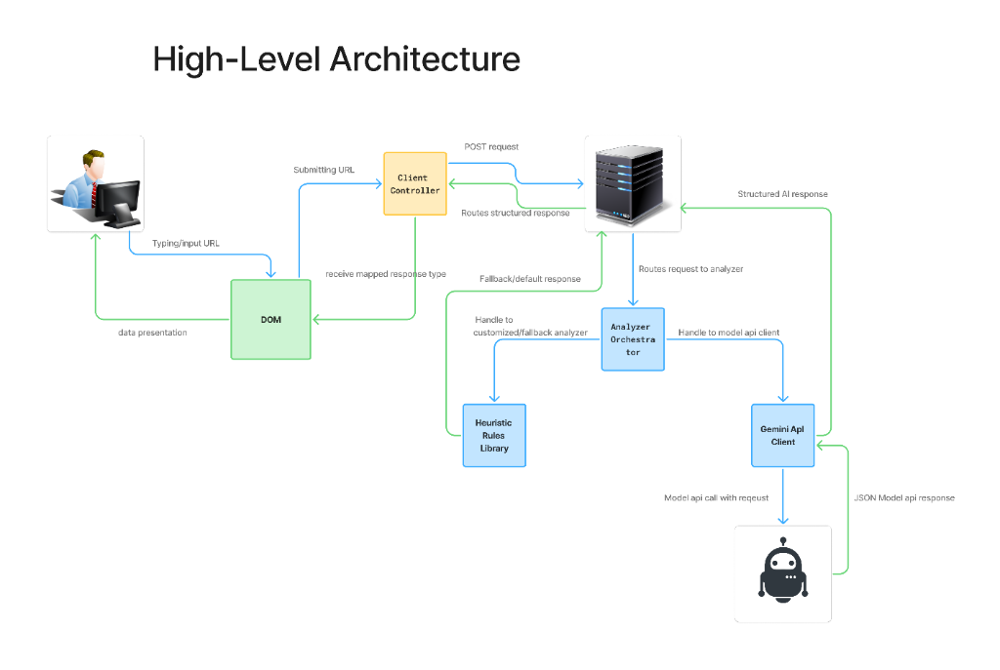

# Fake-Real Detector — Detailed Build Guide (`build.md`)

This document defines the architectural blueprint and step-by-step implementation plan for the **Fake-Real Detector**. It translates the system design into concrete engineering layers and ordered working slices from [`devpost/checklist.md`](file:///c:/Users/PrinceAlan/Documents/DevPost/intern-detector/devpost/checklist.md).

---

## 1. System Architecture



The application follows a decoupled **Client-Server Architecture** designed for clarity, modularity, and testability.

```
[ User ] ──(input)──> [ DOM View ] ──(submit)──> [ Client Controller ] ──(POST /api/analyze)──> [ Express Server ]
                             ▲                                                                           │
                             │                                                                           ▼
                             └──(render HTML)── [ DOM Presenter ] <──(typed response)── [ Analyzer Orchestrator ]
                                                                                               ╱         ╲
                                                                                              ▼           ▼
                                                                                       [Heuristics]    [Gemini API]
```

---

### A. Backend Architecture: **Layered Service & Strategy Pattern**

The backend is organized into four distinct layers so that routing, orchestration, and analysis engines remain completely decoupled:

```
src/
├── types.ts                    ──> [Contracts & DTOs Layer]
│                                   Strict TypeScript interfaces for requests, responses, and findings.
│
├── server.ts                   ──> [HTTP / Router Layer]
│                                   Express app, middleware, static asset hosting, and input validation.
│                                   Only knows how to receive HTTP requests and return HTTP responses.
│
└── analyzer/
    ├── orchestrator.ts         ──> [Orchestration Layer]
    │                               Coordinates analysis between heuristic rules and AI models.
    │                               Determines priority, error handling, and score calibration.
    │
    ├── rules.ts                ──> [Heuristic Strategy Engine]
    │                               High-speed deterministic pattern matcher (upfront fees, salary red flags,
    │                               urgency triggers, free email domains, and verified institutional domains).
    │                               Always available offline with zero API key dependencies.
    │
    └── gemini.ts               ──> [AI Model Strategy Engine]
                                    Google Gemini client that performs contextual deep analysis and returns
                                    structured JSON matching our data contract. Gracefully falls back to rules.
```

#### Key Backend Principles:
1. **Decoupled Engines**: The `server.ts` does not know whether rules or Gemini ran; it only deals with the `Analyzer Orchestrator`.
2. **Strategy Pattern**: The orchestrator can execute the AI model, fall back to heuristic rules, or blend both without affecting the client API contract.
3. **Fail-Safe Operation**: If Gemini is offline, rate-limited, or unconfigured, the system seamlessly returns rule-based analysis.

---

### B. Frontend Architecture: **Controller-Presenter Pattern**

The client-side application is structured to prevent monolithic scripts by dividing responsibilities into distinct modules:

```
public/
└── index.html                  ──> [View / DOM Template]
                                    Semantic layout, responsive container, textarea input, and hidden results shell.
src/client/
├── controller.ts               ──> [Client Controller]
│                                   Listens to DOM events (e.g. click "Check Offer").
│                                   Enforces the Silent Empty Guard (if empty -> silent no-op).
│                                   Manages the loading state ("Checking..." button disable).
│
├── api.ts                      ──> [HTTP Client Service]
│                                   Encapsulates fetch calls to POST /api/analyze.
│                                   Handles network errors and returns typed AnalysisResponse promises.
│
└── presenter.ts                ──> [DOM Presenter / View Model]
                                    Receives typed data and translates it into UI elements:
                                    - Calibrates Tailwind badge color (Emerald for Safe, Amber for Caution, Red for High Risk).
                                    - Injects summary text.
                                    - Generates the two-column findings grid (Reason on Left | Evidences Array on Right).
```

#### Key Frontend Principles:
1. **Silent Empty Guard**: Handled in the controller before any network dispatch, strictly meeting PRD criteria.
2. **Separation of Presentation**: The API client knows nothing about the DOM; the presenter knows nothing about HTTP.
3. **Reactive UI State**: Switching inputs or running multiple checks updates the DOM cleanly without page reloads.

---

## 2. Step-by-Step Implementation Slices

We build and verify one slice at a time. Each slice must be mechanically verified and confirmed before moving to the next.

---

### Slice 1: Backend Foundation, Types & Core Heuristic Engine
- **Focus**: Backend Layers (Contracts, Rules Strategy, Orchestrator, Server).
- **Files**:
  - `package.json`, `tsconfig.json` (Project config & dependencies).
  - `src/types.ts` (`AnalysisRequest`, `AnalysisResponse`, `Finding` with `evidences: string[]`).
  - `src/analyzer/rules.ts` (Deterministic regex pattern library for scam & legit indicators).
  - `src/analyzer/orchestrator.ts` (Core orchestration logic calculating score, verdict, summary).
  - `src/server.ts` (Express server exposing `GET /health` and `POST /api/analyze`).
- **Mechanical Verification**: Automated test script evaluating known scam pitch and verified educational posting, asserting HTTP 200, valid `trustScore`, and non-empty `evidences` array.
- **Learner Check**: Run test script and inspect the structured JSON output in the console.

---

### Slice 2: Web UI Shell, Tailwind Styling & Controller with Empty Guard
- **Focus**: Frontend View & Controller Layers (`index.html`, Tailwind setup, `controller.ts`).
- **Files**:
  - `tailwind.config.js`, `src/client/style.css` (Tailwind CSS configuration).
  - `public/index.html` (Centered responsive layout with title, textarea, and action button).
  - `src/client/controller.ts` (DOM listener, silent empty check, and button loading state).
- **Mechanical Verification**: Compile CSS and client bundle; verify `GET /` serves HTML and assets; test empty input validation.
- **Learner Check**: Open `http://localhost:3000`, test clicking "Check" with empty input (confirm it silently does nothing), then type text to verify "Checking..." state.

---

### Slice 3: Dynamic Results Presenter (Score Badge, Summary, 2-Column Grid)
- **Focus**: Frontend Presenter & End-to-End Rendering (`presenter.ts`, `api.ts`).
- **Files**:
  - `src/client/api.ts` (Fetch wrapper for `/api/analyze`).
  - `src/client/presenter.ts` (DOM builder for dynamic score pill, summary text, and two-column reasons & evidence grid).
- **Mechanical Verification**: Automated test dispatching requests and asserting that DOM elements, badge colors, and evidence tags render correctly.
- **Learner Check**: Paste a scam offer into the browser and inspect the red score badge with itemized reasons; paste a legitimate job offer and inspect the green score badge.

---

### Slice 4: Gemini AI Strategy & Resilient Fallback
- **Focus**: AI Strategy Integration (`src/analyzer/gemini.ts`).
- **Files**:
  - `src/analyzer/gemini.ts` (Google Gemini API integration with structured JSON prompting).
  - Update `src/analyzer/orchestrator.ts` (Integrate Gemini call with automated try/catch fallback to rules).
- **Mechanical Verification**: Test analysis with API key (or mock) and without key, verifying identical schema compliance in all conditions.
- **Learner Check**: Test varied inputs with and without `.env` key to confirm seamless resilience.

---

## 3. Hands-On Checkpoints & Review

- **Checkpoint 1 (After Slice 2)**: Early hands-on testing of the UI and empty guard.
- **Checkpoint 2 (After Slice 4)**: Full kick-the-tires testing with real-world scam and legitimate postings.
- **Learning Wrap-Up**: Generation of `devpost/app-map.html` and code walkthrough to consolidate reusable patterns.
