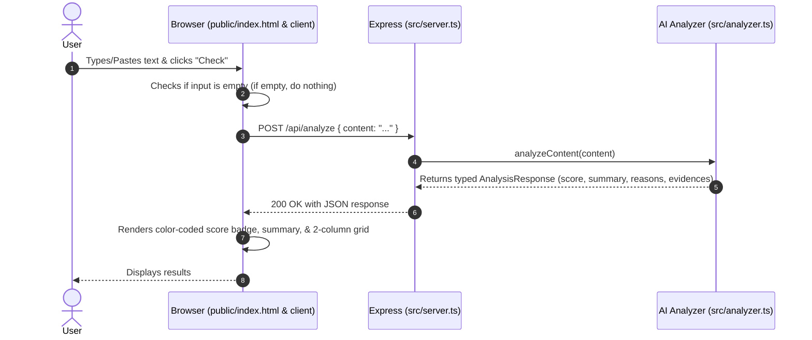

# Fake-Real Detector — Technical Spec

## How This Works, In Plain Language

The Fake-Real Detector is split into two connected parts, built with **TypeScript** and styled with **Tailwind CSS**:
1. **The Frontend (Browser)**: A single webpage with a title, a centered input box, a "Check" button, and a dynamic results panel. When you paste text or a URL and click "Check", the client packages your input and sends it to the server. If the input is empty, it does nothing.
2. **The Backend (Server)**: A Node.js/Express service written in **TypeScript**. When it receives your text or link, it passes it to an **Analyzer Service**. The analyzer examines the content for red flags (or positive trust signals) and returns a strictly typed verdict: a score (1–10), a summary description, and a list of specific reasons—each paired with an array of verbatim evidence snippets extracted from your input.

Once the frontend gets this data back, it updates the page: color-coding the score from safe green to warning red, printing the summary, and laying out the reasons on the left with their matching array of evidence on the right using a clean, responsive Tailwind CSS grid.

Why this shape? It gives you full type safety across data contracts using TypeScript, rapid and polished UI styling with Tailwind CSS, and a clear separation between client presentation and analysis logic.

---

## The Core Journey Through the System

Implements: `prd.md > The Core Journey`




1. **User lands on page**: Browser requests `GET /` → Express serves `public/index.html`, Tailwind-compiled stylesheet (`public/dist/output.css`), and the compiled client bundle/script.
2. **User inputs text/URL & clicks Check**: The client-side TypeScript listener captures the click event.
   - If `input.trim() === ""`: Execution halts immediately (silent no-op, per `prd.md > Edge Cases & Input Handling`).
   - If non-empty: UI sets button state to "Checking..." and makes a `POST /api/analyze` request with `{ content: "..." }`.
3. **Server processes request**: `server.ts` validates payload types against `AnalysisRequest` interface and routes to `src/analyzer.ts`.
4. **Analysis executes**: The analyzer runs rules and AI extraction to generate a typed `AnalysisResponse` object containing the score (1–10), overall verdict, summary, and findings with reason strings and evidence arrays.
5. **Server replies**: Returns HTTP 200 with the typed analysis JSON payload.
6. **Frontend displays results**: Client script receives the response, adjusts Tailwind color classes based on the score (emerald/green for high trust, red for high risk), updates the summary text, and renders the two-column grid showing reasons and their list of evidence tags.

---

## Stack

- **Language**: **TypeScript** (v5+) across both backend and frontend.
  - *Rationale*: Type safety prevents runtime contract bugs between API and UI. Explicit data models (`src/types.ts`).
  - [TypeScript Documentation](https://www.typescriptlang.org/)
- **Backend Framework**: Node.js with **Express** (`express`, `@types/express`) executed via `tsx` (TypeScript Execute).
  - *Rationale*: Modern, fast TypeScript execution without cumbersome manual build steps during development.
  - [Express Documentation](https://expressjs.com/)
- **Styling Framework**: **Tailwind CSS** (v4 or CLI).
  - *Rationale*: Utility-first CSS for clean modern typography, responsive cards, and dynamic color-coded badges without writing bloated custom CSS.
  - [Tailwind CSS Documentation](https://tailwindcss.com/)
- **Frontend Markup & Scripts**: Semantic HTML5 and TypeScript compiled to client JavaScript.
- **AI & Analysis Engine**: Node.js service using the **OpenRouter API** (via the `openai` SDK pointed at `https://openrouter.ai/api/v1`) with a structured local heuristic engine as an automated fallback.
  - *Rationale*: Guarantees the app works 100% reliably in offline or keyless environments during demo recording while leveraging AI capabilities when an API key is present. OpenRouter provides access to multiple models through a single API.
  - [OpenRouter API Documentation](https://openrouter.ai/docs)
- **Environment Management**: `dotenv` for reading `.env` variables safely.

---

## Where It Runs and How Someone Tries It

- **Runtime**: Runs locally as a Node.js TypeScript web server.
- **Environment**: Node.js installed; optional `.env` file with `OPENROUTER_API_KEY`.
- **How to Start**:
  ```bash
  npm install
  npm run build:css   # Builds Tailwind CSS output
  npm start           # Starts the TypeScript server via tsx
  ```
- **What to Open**: Open `http://localhost:3000` in any modern web browser.
- **Demo Recording**: Open `http://localhost:3000`, paste a sample scam pitch (or legitimate link), click "Check", and record the resulting score badge, summary, and evidence breakdown.
- **Submission Requirement**: Verified locally for short demo video and pushed to the public GitHub repository. Cloud deployment is optional.

---

## Look and Feel

Implements: `prd.md > Look and Feel` & `prd.md > Screens and Layout`

- **Layout**: Centered container (`max-w-3xl mx-auto px-4 py-12`), generous spacing, clean modern typography (`font-sans`).
- **Tailwind Color Scale (Trust Score)**:
  - **High Trust (8–10)**: Emerald / Green (`bg-emerald-50 text-emerald-700 border-emerald-300`).
  - **Moderate / Caution (5–7)**: Amber / Yellow (`bg-amber-50 text-amber-700 border-amber-300`).
  - **High Risk (1–4)**: Red / Rose (`bg-red-50 text-red-700 border-red-300`).
- **Results Presentation**:
  - Score badge: Modestly sized pill (`inline-flex items-center px-3 py-1 rounded-full text-sm font-semibold border`).
  - Summary: Crisp lead paragraph (`text-gray-700 mt-3 text-base leading-relaxed`).
  - Two-Column Grid (`grid grid-cols-1 md:grid-cols-2 gap-4 mt-6`):
    - **Left Column**: Reason title & pattern description.
    - **Right Column**: Flex-wrap list of distinct evidence tags (`inline-block bg-gray-100 text-gray-800 text-xs px-2.5 py-1 rounded border border-gray-200`) showing exact snippets found in the content.

---

## Components

### 1. Web UI Client (`public/index.html`, `src/client/app.ts`)
- **Responsibility**: Renders input controls, listens for user submission, enforces silent no-op for empty inputs, and builds the visual score and reasons/evidence DOM using Tailwind utility classes.
- **PRD Refs**: `prd.md > Screens and Layout`, `prd.md > Look and Feel`, `prd.md > Edge Cases & Input Handling`.

### 2. API Server (`src/server.ts`)
- **Responsibility**: Hosts static assets from `public/`, parses incoming JSON requests, provides the health route (`GET /health`) and analysis endpoint (`POST /api/analyze`).
- **PRD Refs**: `prd.md > The Core Journey`.

### 3. Analyzer Engine (`src/analyzer.ts`)
- **Responsibility**: Evaluates text and URLs against scam criteria (e.g., upfront payment, unrealistic salary, urgency tactics, free email domains) and legitimacy signals (e.g., university/official domain, standard recruitment workflow).
- **PRD Refs**: `prd.md > Features and Behavior > 1. Scam & Legitimacy Evaluation` & `2. Side-by-Side Reasons & Evidence`.

### 4. Shared Type Definitions (`src/types.ts`)
- **Responsibility**: Defines contracts for `AnalysisRequest`, `AnalysisResponse`, `Finding`, and verdict levels used across the system.

---

## Data Model (`src/types.ts`)

```typescript
export interface Finding {
  reason: string;
  evidences: string[];
}

export type Verdict = "Safe" | "Caution" | "High Risk";

export interface AnalysisRequest {
  content: string;
}

export interface AnalysisResponse {
  trustScore: number; // 1 to 10
  verdict: Verdict;
  summary: string;
  findings: Finding[];
}
```

---

## File Structure (Monorepo)

```
intern-detector/
├── backend/                  # Isolated Backend Service (@intern-detector/backend)
│   ├── src/
│   │   ├── analyzer/
│   │   │   ├── orchestrator.ts     # Analysis orchestrator (OpenRouter + Rules fallback)
│   │   │   ├── rules.ts            # Heuristic scam and legitimacy pattern library
│   │   │   ├── openrouter.ts       # OpenRouter API client wrapper
│   │   │   ├── rules.test.ts       # Pattern matching unit tests
│   │   │   ├── orchestrator.test.ts# Scoring & verdict unit tests
│   │   │   └── openrouter.test.ts  # AI integration & fallback tests
│   │   ├── server.ts               # Express API (/api/analyze, /health, CORS)
│   │   ├── server.test.ts          # Server endpoint integration tests
│   │   └── types.ts                # Backend data contracts & DTOs
│   ├── package.json          # Backend-specific dependencies (express, cors, dotenv)
│   └── tsconfig.json         # Backend TypeScript configuration
├── frontend/                 # Isolated Frontend App (@intern-detector/frontend)
│   ├── src/
│   │   ├── controller.ts           # Client controller with Silent Empty Guard
│   │   ├── controller.test.ts      # Controller input guard tests
│   │   ├── presenter.ts            # Dynamic DOM presenter (badges & 2-column grid)
│   │   ├── presenter.test.ts       # Badge theme & evidence tag unit tests
│   │   ├── presenter.dom.test.ts   # DOM presentation integration tests
│   │   ├── api.ts                  # HTTP client calling backend /api/analyze
│   │   ├── style.css               # Tailwind CSS utility stylesheet
│   │   ├── app.ts                  # Client entrypoint and DOM binder
│   │   └── types.ts                # Frontend data models & contracts
│   ├── dist/
│   │   ├── output.css              # Compiled Tailwind stylesheet
│   │   └── app.js                  # Bundled client script
│   ├── index.html            # Main interface markup
│   ├── package.json          # Frontend-specific dependencies & build scripts
│   └── tsconfig.json         # Frontend TypeScript configuration
├── resources/                # Architectural diagrams and visual design assets
│   ├── high-level-architecture.png
│   ├── low-level-architecture.png
│   ├── full-flowchart.png
│   └── mermaid-diagram.svg
├── scripts/
│   └── test-openrouter.ts    # Direct OpenRouter connection diagnostic script
├── devpost/                  # Hackathon documentation
│   ├── learner-profile.md
│   ├── scope.md
│   ├── prd.md
│   ├── spec.md
│   ├── checklist.md
│   └── app-map.html
├── .env.example              # Secret-free environment template
├── .gitignore                # Excludes credentials and build artifacts
├── package.json              # Monorepo root workspace orchestrator
└── README.md                 # Project documentation and setup instructions
```

---

## External Services and Dependencies

- **`typescript`** (`^5.0.0`) & **`tsx`** (`^4.0.0`): Type-checking and runtime execution.
- **`express`** (`^4.19.0`) & **`@types/express`**: Server framework and type definitions.
- **`tailwindcss`** (`^3.4.0` or `^4.0.0`): CSS utility styling framework.
- **`dotenv`** (`^16.4.0`): Local environment variable loader.
- **OpenRouter Client**: Direct API client (via native `fetch` to `https://openrouter.ai/api/v1`) with graceful fallback.

---

## Important Failure Modes

1. **Empty / Whitespace Input**:
   - *Behavior*: Frontend intercepts immediately; does not call the server. Page remains in current state with zero errors shown.
2. **AI API Rate Limit or Network Disconnection**:
   - *Behavior*: Server catches AI exceptions and seamlessly runs the local heuristic rule engine (`src/rules.ts`), ensuring the user always receives a typed score and evidence breakdown.
3. **Invalid or Malformed Server Payload**:
   - *Behavior*: Server validates input with TypeScript guards and returns HTTP 400 `{ "error": "Content is required" }`. Frontend displays an inline notice without crashing.

---

## What Was Simplified and Why

- **TypeScript with `tsx`**: Provides type safety without requiring multi-step build pipelines for the backend server.
- **Tailwind CSS Utility Classes**: Delivers clean, responsive, modern aesthetics and score badge colors without maintaining large custom CSS files.
- **Heuristic + AI Hybrid**: Guarantees test and demo recording success even without an API key.

---

## Decisions and Open Issues

- **Learner Decision**: Confirmed **TypeScript** for full type safety across the project.
- **Learner Decision**: Confirmed **Tailwind CSS** for the UI styling framework.
- **Learner Decision**: Confirmed `evidences` array per finding (`evidences: string[]`).
- **Open Questions**: None blocking. Ready for step-by-step implementation in `5-build`.
